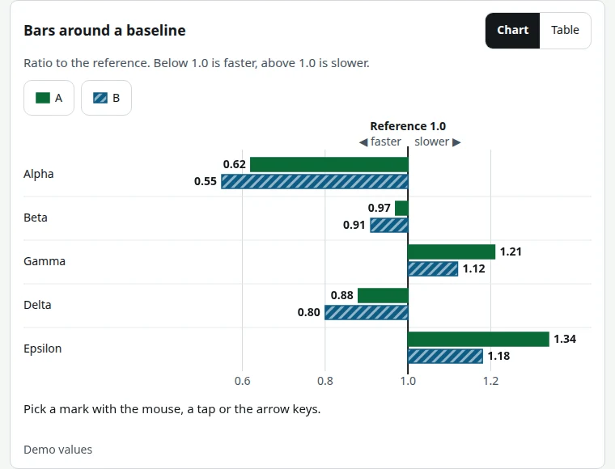

# PSOrvia Charts

[](https://h-peterseim.github.io/psorvia-charts/demo.html)

**Animeeritud, ligipääsetavad diagrammid sinu veebilehele**

### ▶ [Otsedemo](https://h-peterseim.github.io/psorvia-charts/demo.html)

Tulbad ümber algjoone, rühmitatud tulbad, jooned, võtenumbrite paanid ja tabelivaade. Puhas JavaScript ja CSS ilma sõltuvusteta: väärtused asuvad märkide kõrval, iga diagramm töötab klaviatuuriga ja vähendatud liikumise korral ei liigu miski.

## Kasutamine

```html
<link rel="stylesheet" href="psorvia-charts.css">
<script src="psorvia-charts.js"></script>
<div id="speed"></div>
<script>
PsoCharts.create(document.getElementById('speed'), {
  type: 'bars', title: 'Speed', baseline: 1, baselineLabel: 'Reference 1.0', sides: ['faster', 'slower'],
  categories: [{ label: 'Read' }, { label: 'Write' }],
  series: [{ name: 'Run A', values: [0.8, 1.2] }, { name: 'Run B', values: [0.7, 1.1] }]
});
</script>
```

```html
<script type="module">
import { create, auto } from './psorvia-charts.esm.js';
auto();
</script>
```

## Diagrammitüübid

| `type` | Näitab |
|---|---|
| `bars` | Ühte tulpa väärtuse kohta, mis kasvab algjoonelt (`baseline: 1` eraldab kiirema aeglasemast). Mitu andmerida annavad rühmitatud tulbad. |
| `lines` | Ühte joont andmerea kohta üle kategooriate, joone lõpus sildiga. |
| `tiles` | Võtenumbrite paanid koos ülespoole loendava numbri, märgi (▲ ▼ =) ja lühikese tekstiga. |
| `table` | Lihtne tabel. |

`bars` ja `lines` on varustatud diagrammi ja tabeli vahelüliti, andmeridu peitva legendi ning diagrammi all oleva näiduga.

## Valikud

| Valik | Vaikimisi | |
|---|---|---|
| `type` | | `bars`, `lines`, `tiles` või `table` |
| `title` | | Diagrammi pealkiri, ühtlasi ligipääsetav nimi |
| `desc` | | Lühikirjeldus pealkirja all |
| `categories` | | `[{ label, note }]`, `note` kuvatakse näidus ja tabelis |
| `series` | | `[{ name, values }]`, `null` puuduva väärtuse jaoks |
| `baseline` | puudub (bars: 0) | Võrdlusväärtus, joonistatud joonena |
| `baselineLabel` | | Tekst algjoone juures, näiteks `Reference 1.0` |
| `sides` | | `[below, above]`, algjoone kahe külje nimed, kõlavad ka näidus ette |
| `unit` | | Lisatakse igale arvule, näiteks `' ms'` |
| `digits` | `2` | Kümnendkohad |
| `catHeader` | | Tabeli esimese veeru päis |
| `source` | | Jalusetekst diagrammi all |
| `legend` | `true` | `false` peidab legendi |
| `zero` | `false` | Jooned: lisa väärtustelje peale 0 |
| `labels` | inglise keel | `{ chart, table, view, na, hint, keys }`, sinu enda sõnastus |
| `lang` | lehe keel | Arvuvorming, `Intl.NumberFormat` kaudu |
| `style` | `house` | `house`, `gauge`, `plain` või `genre` |
| `theme` | automaatne | `light` või `dark` ühe sundimiseks |
| `motion` | automaatne | `off` lülitab animatsiooni välja |
| `items` | | Ainult paanid: `[{ label, value, unit, digits, mark, sub, tone }]`, `tone` on `good`, `bad` või `neutral` |

## API

- `PsoCharts.create(element, spec, options)` joonistab diagrammi elementi `element` ja tagastab selle. `options` võtab `style`, `theme`, `motion` ja `lang` spetsifikatsiooni vaikeväärtustena.
- `chart.set(spec)` asendab andmed, `chart.show('chart' | 'table')` vahetab vaadet, `chart.destroy()` eemaldab diagrammi.
- `PsoCharts.auto(root)` joonistab iga lehel oleva `<div data-pso-chart>`. Atribuut sisaldab valikuid JSON-ina, `data-chart-source="#id"` nimetab andmeallika.
- `PsoCharts.read(element)`, `fromLd(json, id)` ja `fromTable(table)` muudavad andmeallika spetsifikatsiooniks.

## Andmeallikad

Andmed võivad tulla kolmest kohast. Valikud nagu `type` ja `baseline` lähevad alati atribuuti `data-pso-chart`.

**JSON-LD (schema.org Dataset).** Arvud asuvad lehel struktureeritud andmetena, mida saavad lugeda ka masinad. Iga andmerida on `PropertyValue` väljas `variableMeasured`; selle `valueReference` loetleb kategooria kohta ühe `PropertyValue` koos `name` ja `value`:

```html
<script type="application/ld+json" id="data">
{ "@context": "https://schema.org", "@type": "Dataset", "@id": "https://example.org/p#speed",
  "name": "Speed", "creator": { "@type": "Organization", "name": "Example" },
  "measurementTechnique": "Wall clock", "isBasedOn": { "@type": "SoftwareSourceCode", "name": "Example", "version": "1.2.0" },
  "variableMeasured": [
    { "@type": "PropertyValue", "name": "Run A", "unitText": "ratio",
      "valueReference": [ { "@type": "PropertyValue", "name": "Read", "value": 0.8 }, { "@type": "PropertyValue", "name": "Write", "value": 1.2 } ] } ] }
</script>
<div data-pso-chart='{"type":"bars","baseline":1,"dataset":"https://example.org/p#speed"}' data-chart-source="#data"></div>
<script>PsoCharts.auto();</script>
```

Mitme andmekogumi korral ühes `@graph`-is nimetab `dataset` kasutatava `@id`. Looja, meetod ja `isBasedOn` (koos `version`-iga) muutuvad jaluseks. Kategooria väärtuse `description` muutub selle märkuseks. Valisime `PropertyValue`, sest see on stabiilne schema.org tüüp; `Observation` on seal veel märgitud ootel olevaks.

**HTML-tabel.** Olemasolev tabel jääb lehele, skriptiga või ilma. Diagramm lisatakse selle kõrvale. Veergude päised on andmeread, reapäised kategooriad, lahtri atribuut `data-value` hoiab täpset arvu:

```html
<table id="t"><caption>Speed</caption>
<thead><tr><th></th><th scope="col">Run A</th></tr></thead>
<tbody><tr><th scope="row">Read</th><td data-value="0.8">0.80</td></tr></tbody></table>
<div data-pso-chart='{"type":"bars"}' data-chart-source="#t"></div>
```

**Lihtne JSON.** `<script type="application/json">` spetsifikatsiooniga (`categories`, `series`, ...) või spetsifikatsioon otse `PsoCharts.create` kutses.

## Stiilid ja värvid

Värvid on CSS-i kohandatud omadused elemendil `.pc`, heleda ja tumeda jaoks (süsteemi seadistus, `:root[data-theme]` või `data-pc-theme`):

| Omadus | |
|---|---|
| `--pc-bg`, `--pc-fg`, `--pc-mut` | Taust, tekst, teisejärguline tekst |
| `--pc-grid`, `--pc-sep` | Ruudustiku jooned, eraldajad |
| `--pc-0` kuni `--pc-3` | Andmeridade värvid |
| `--pc-good`, `--pc-bad` | Paani serv parema ja halvema jaoks |
| `--pc-cur` | Valitud märgi kontuur |
| `--pc-font`, `--pc-r` | Kirjatüüp ja nurkade raadius |

`data-pc-style` (või valik `style`) valib ühe nelja komplekti seast: `house` (roheline), `gauge` (merevaik paberil või must, püsilaiusega), `plain` (mustvalge ühe rõhuvärviga) ja `genre` (soe). Määra omadused elemendil `.pc` või üksikul diagrammil, et kasutada enda omi.

## Ligipääsetavus

- Pilt on sildiga `img`; selle all on klaviatuuriala: Tab jõuab diagrammini, nooleklahvid liiguvad märkide vahel, Home ja End hüppavad, Escape tühistab valiku. Valitud märk kontuuritakse ja loetakse ette `aria-live` piirkonnas.
- Igal diagrammil on tabelivaade korrektsete päistega. Andmeread erinevad mustri (tulbad) ja kuju (jooned) poolest, mitte ainult värvi poolest; parem ja halvem paanidel märgi ja sõna poolest.
- Kogu tekst on vähemalt 13 px ja kontrast on vähemalt 4,5:1; märkidel vähemalt 3:1. Testikomplekt kontrollib kõiki nelja stiili heledas ja tumedas.
- Vähendatud liikumise korral (süsteemi seadistus või `motion: 'off'`) joonistatakse tulbad ja jooned korraga ning numbrid ei loenda üles.

## Jõudlus

Umbes 23 KB skripti ja 8 KB CSS-i, kokku umbes 10 KB gzip-tihendatult, ilma sõltuvusteta. Diagramme joonistatakse uuesti ainult laiuse muutumisel; animatsioon kasutab CSS-i ja algab, kui diagramm kerimisel vaatesse jõuab.

## Testid

`python3 tools/build.py` ehitab kolm faili kaustast `src/`. `python3 tests/browser.py` avab `demo.html` peata Chromiumis (vajab Pythoni paketti `websockets`), kontrollib kontrasti, kirjasuurust, klaviatuuri, tabelivaadet ja vähendatud liikumist ning `--photos <folder>` salvestab ekraanipildid heledas, tumedas ja vähendatud liikumisega.

## Tõlked

[English](../../README.md) · [Deutsch](README.de.md) · [Български](README.bg.md) · [Čeština](README.cs.md) · [Dansk](README.da.md) · [Ελληνικά](README.el.md) · [Español](README.es.md) · [Eesti](README.et.md) · [Suomi](README.fi.md) · [Français](README.fr.md) · [Gaeilge](README.ga.md) · [Hrvatski](README.hr.md) · [Magyar](README.hu.md) · [Italiano](README.it.md) · [Lietuvių](README.lt.md) · [Latviešu](README.lv.md) · [Malti](README.mt.md) · [Nederlands](README.nl.md) · [Polski](README.pl.md) · [Português](README.pt.md) · [Română](README.ro.md) · [Slovenčina](README.sk.md) · [Slovenščina](README.sl.md) · [Svenska](README.sv.md)

## Litsents

Kood on MIT-litsentsi all (vt [LICENSE](../../LICENSE)). Demoväärtused on välja mõeldud (vt [media/LICENSE.md](../../media/LICENSE.md)).

SPDX-License-Identifier: MIT

Tehtud saidile [psorvia.io](https://psorvia.io).
